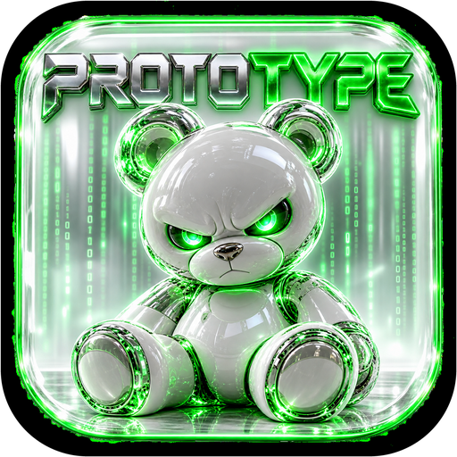

<div align="center">



# Prototype

**A Second Life viewer by Ryan Johnson.**
Clear glass, neon green, and the bear.

[www.prototypesl.com](https://www.prototypesl.com)

<sub>This software is not provided or supported by Linden Lab, the makers of Second Life.</sub>

</div>

## What it is

Prototype is a fast, modern Second Life viewer written in Rust with a Vulkan
renderer. It keeps the full Second Life feature set (chat, IMs, friends,
groups, inventory, building, teleports, voice) with its own look:

- Frosted white glass windows with green window dots
- A Firestorm-style layout: text menus, navigation bar, labelled toolbar
- Friends list with an "Online now" row and green online rings
- Profiles with a big banner and a glowing picture ring
- Avatars and objects load in with a Matrix code-rain effect
- Your choice of login background

Version 1.0.0.

## Build

Requirements: Rust (stable, picked automatically by `rust-toolchain.toml`) and
a GPU with Vulkan support.

```bash
cargo build --release -p prototype-viewer
./target/release/prototype-viewer
```

On Windows, `cargo build --release -p prototype-viewer` gives
`target\release\prototype-viewer.exe` with the Prototype icon. On Debian or
Ubuntu, install `build-essential cmake clang pkg-config libasound2-dev
libudev-dev libxkbcommon-dev libwayland-dev` first.

## Licence

Prototype is free software under the GNU General Public License, version 3 or
later: see [LICENSE](LICENSE) and [NOTICE.md](NOTICE.md).

Second Life® is a trademark of Linden Research, Inc. Prototype is not provided,
endorsed or supported by Linden Lab.
